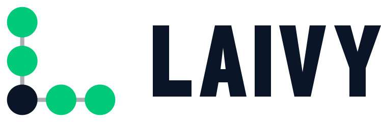
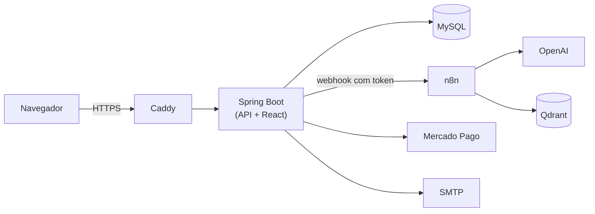

<p align="center">
  <picture>
    <source media="(prefers-color-scheme: dark)" srcset="frontend/public/img/logo/horizontal/laivy-horizontal-escuro.svg">
    
  </picture>
</p>

<p align="center">
  
  
  
  
  
  
</p>

# LAIVY

Sistema web para gestão de times de basquete, feito como TCC do curso técnico da ETEC, em 2026.

No LAIVY o treinador cadastra o elenco, marca treinos e jogos, registra exames e o desempenho
dos atletas, monta jogadas numa prancheta e tira dúvidas com um assistente que conhece os
dados do próprio time.

## O que dá para fazer

- Cadastrar usuários em quatro perfis: administrador, treinador, atleta e preparador físico.
  Cada perfil vê só o que precisa; o atleta, por exemplo, vê apenas os próprios dados.
- Montar a escalação na quadra, agendar atividades (inclusive recorrentes), lançar resultados
  de jogos e acompanhar o desempenho em gráficos.
- Guardar exames com foto.
- Desenhar jogadas na prancheta: a quadra segue o padrão FIBA, a jogada tem vários quadros que
  viram uma animação, e dá para exportar em PNG ou PDF. Também existem formações defensivas
  prontas (zona 2-3, 3-2, 1-3-1 e individual).
- Conversar com o assistente de IA, que responde sobre o time, sugere e ajusta jogadas e
  consegue cadastrar vários atletas de uma vez a partir de um PDF ou CSV.
- Treinadores podem se cadastrar sozinhos, assinar um plano via PIX (Mercado Pago) e convidar
  atletas por e-mail.
- O administrador tem um painel com a visão geral do sistema e o histórico de ações dos
  usuários.

## Como funciona por dentro



O back-end é uma API em Java 21 com Spring Boot 3.5. O front-end é React 19 com Vite; o build
dele é servido pelo próprio Spring, então a aplicação roda num único container. O banco é
MySQL, com as mudanças de estrutura versionadas pelo Flyway.

O assistente roda num workflow do n8n. O backend envia a pergunta junto com o contexto que o
usuário tem permissão de ver, e o n8n usa a OpenAI e uma base vetorial no Qdrant (com a
documentação do sistema) para responder. Quando precisa ler ou alterar algo, ele chama a
própria API, sempre com as permissões de quem perguntou.

Outras bibliotecas usadas: Bootstrap, Chart.js e FullCalendar no front; JJWT, jBCrypt,
Apache Batik e PDFBox no back. Em produção, o Caddy cuida do HTTPS.

## Segurança

Alguns cuidados que tomamos:

- O login usa JWT guardado em cookie `HttpOnly` e `SameSite=Strict`, e as senhas são salvas
  com BCrypt. Cada usuário tem uma versão de token, o que permite encerrar todas as sessões
  dele de uma vez.
- A senha inicial é temporária, chega por e-mail e precisa ser trocada no primeiro acesso.
- As permissões são checadas no back-end, por perfil e por time.
- Nenhum segredo fica no código: tudo vem de variáveis de ambiente, e há scripts para gerar e
  trocar esses valores.
- Em produção só as portas 80 e 443 ficam abertas, e o Caddy envia os cabeçalhos de segurança
  (CSP, HSTS e outros).

## Rodando localmente

Precisa do Docker Desktop instalado.

```bash
git clone https://github.com/IagoSBX/laivy_Ds.git
cd laivy_Ds
cp .env.example .env
docker compose up --build
```

Depois é só abrir http://localhost:8080. Os e-mails enviados em desenvolvimento não saem de
verdade; eles aparecem no Mailpit, em http://localhost:8025.

As contas de exemplo (`admin`, `treinador` e `atleta`) ganham uma senha temporária na primeira
vez que o sistema sobe. Para descobrir qual é:

```bash
docker logs laivy-backend | grep "Senha padrao"
```

Para gerar segredos fortes no `.env`, rode `python3 scripts/rotacionar-segredos.py` com os
containers no ar e depois `docker compose up -d --force-recreate backend n8n`.

O assistente de IA é opcional. Para usá-lo, abra o n8n em http://localhost:5678, importe os
workflows da pasta `n8n/workflows/` e cadastre suas credenciais da OpenAI e do Qdrant.

Para mexer no front com recarga automática, deixe o Docker rodando e use:

```bash
npm --prefix frontend ci
npm --prefix frontend run dev
```

Os testes rodam com `mvn test` (back-end) e `npm --prefix frontend test` (front-end). O passo a
passo para colocar num servidor está no [DEPLOY.md](DEPLOY.md).

## Organização das pastas

```
src/main/java/br/com/gerenciador/projeto/
    controller/   endpoints da API
    service/      regras de negócio, assistente, PIX e exportação
    DAO/          acesso ao banco
    model/        entidades
    security/     JWT, auditoria e proteção das senhas iniciais
src/main/resources/db/migration/   migrations do Flyway
frontend/src/
    pages/        uma tela por arquivo
    components/   componentes reaproveitados entre telas
    prancheta/    editor de jogadas
    lib/          chamadas à API, sessão, máscaras e validações
n8n/workflows/    workflows do assistente
deploy/           configuração do Caddy
scripts/          segredos e backup
```

A documentação completa entregue no TCC está em
[LAIVY_Documentacao_Completa_v2.pdf](LAIVY_Documentacao_Completa_v2.pdf). Ela é de junho de
2026, de uma versão anterior à migração para React.

## Equipe

Iago Silva, Victor Hugo, Yago Ribeiro, Leonardo Assis e João Pedro.
