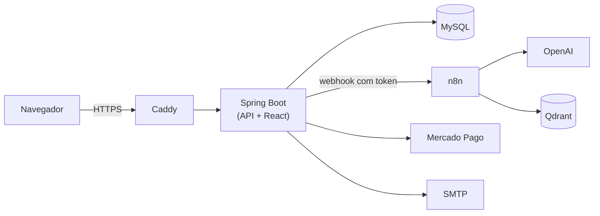

<p align="center">
  <picture>
    <source media="(prefers-color-scheme: dark)" srcset="frontend/public/img/logo/horizontal/laivy-horizontal-escuro.svg">
    
  </picture>
</p>

<p align="center"><em>For those who live the game.</em></p>

<p align="center">
  
  
  
  
  
  
  
</p>

**LAIVY** é uma plataforma web de gestão para times de basquete. Ela reúne num só lugar o
elenco, a agenda, os exames e o desempenho dos atletas, uma **prancheta tática animada** e um
**assistente de IA** que conhece os dados do time.

Projeto de TCC do curso técnico da **ETEC (2026)**.

---

## Destaques

- **Prancheta tática** – editor de jogadas em SVG com quadra FIBA, linha do tempo de frames,
  animação, desfazer/refazer, formações defensivas prontas (zona 2-3, 3-2, 1-3-1, individual) e
  exportação em **PNG** e **PDF**. Tem também um chat de IA que movimenta os jogadores direto no editor.
- **Assistente de IA com RAG** – chat que responde sobre o time, os atletas e a documentação do
  sistema, sugere e edita jogadas e cadastra atletas em lote a partir de um PDF ou CSV anexado.
  Roda em um workflow **n8n** com **OpenAI** e base vetorial **Qdrant**.
- **Gestão do time** – usuários com quatro perfis (Administrador, Treinador, Atleta e Preparador
  Físico), times, escalação na quadra, atividades com recorrência, calendário de jogos e
  pontuação, exames com foto e desempenho com gráficos.
- **Planos e convites** – autocadastro de treinador, assinatura via **PIX (Mercado Pago)** e
  convites de atletas por e-mail.
- **Painel administrativo** – visão geral do sistema e **log de auditoria** das ações dos usuários.

## Arquitetura



- O **frontend React** é compilado pelo Vite e servido pelo próprio Spring Boot, então a
  aplicação vira um único container.
- O **n8n** recebe a pergunta já com o contexto que o usuário pode ver e chama ferramentas
  da API para ler ou alterar dados, sempre com as permissões desse usuário.
- O banco é versionado com **Flyway** (`src/main/resources/db/migration`).

## Stack

| Camada | Tecnologias |
|---|---|
| Backend | Java 21, Spring Boot 3.5 (Web, Data JPA, Validation, Mail), Flyway, JJWT, jBCrypt, Apache Batik e PDFBox |
| Frontend | React 19, React Router 7, Vite, Bootstrap 5, Chart.js, FullCalendar |
| Dados | MySQL 8.4 |
| IA | n8n, OpenAI, Qdrant |
| Infra | Docker Compose, Caddy (HTTPS automático), Mailpit para e-mails em desenvolvimento |

## Segurança

- Autenticação com **JWT em cookie `HttpOnly` e `SameSite=Strict`**, senhas com **BCrypt**.
  Uma versão de token por usuário permite derrubar todas as sessões dele.
- Senhas temporárias enviadas por e-mail, com troca obrigatória no primeiro acesso. As contas de
  exemplo recebem uma senha aleatória na primeira subida.
- Regras de acesso por perfil e por time no backend. O atleta só vê os próprios dados.
- Cabeçalhos de segurança (CSP, HSTS e outros) no Caddy. Em produção, só as portas 80 e 443
  ficam expostas.
- Segredos só por variáveis de ambiente (`.env`, fora do Git), com scripts para gerá-los e
  trocá-los.

## Como rodar

**Pré-requisito:** Docker Desktop.

```bash
git clone https://github.com/IagoSBX/laivy.git
cd laivy
cp .env.example .env
docker compose up --build
```

1. Abra **http://localhost:8080**. Os e-mails enviados em desenvolvimento aparecem no Mailpit,
   em http://localhost:8025.
2. As contas iniciais (`admin`, `treinador` e `atleta`) recebem uma senha temporária na primeira
   subida. Para vê-la:

   ```bash
   docker logs laivy-backend | grep "Senha padrao"
   ```

3. **Segredos fortes (recomendado):** com os containers no ar, rode
   `python3 scripts/rotacionar-segredos.py` e depois
   `docker compose up -d --force-recreate backend n8n`.
4. **Assistente de IA (opcional):** abra o n8n em http://localhost:5678, importe os workflows de
   `n8n/workflows/` e cadastre as credenciais da OpenAI e do Qdrant.

### Desenvolvimento

Com o Docker no ar, o frontend pode rodar com recarga automática:

```bash
npm --prefix frontend ci
npm --prefix frontend run dev    # abre em :5173 e repassa as chamadas da API para :8080
```

**Testes:** `mvn test` (backend) e `npm --prefix frontend test` (frontend).

**Produção:** o guia [DEPLOY.md](DEPLOY.md) cobre VPS, HTTPS, segredos, n8n e backups.

## Estrutura

```
├── src/main/java/br/com/gerenciador/projeto/
│   ├── controller/   endpoints REST
│   ├── service/      regras de negócio, IA, PIX, exportação PNG/PDF
│   ├── DAO/          repositórios JPA
│   ├── model/        entidades
│   └── security/     JWT, auditoria, proteção das senhas padrão
├── src/main/resources/db/migration/   migrations Flyway
├── frontend/src/
│   ├── pages/        uma tela por arquivo
│   ├── components/   componentes compartilhados
│   ├── prancheta/    motor do editor de jogadas (domínio, editor, player, IA)
│   └── lib/          API, sessão, máscaras e validações
├── n8n/workflows/    workflows do assistente de IA
├── deploy/           Caddyfile de produção
└── scripts/          geração e troca de segredos, backup
```

A documentação técnica completa do TCC está em
[LAIVY_Documentacao_Completa_v2.pdf](LAIVY_Documentacao_Completa_v2.pdf). Ela é de junho de
2026 e descreve uma versão anterior, sem o React.

## Equipe

Iago Silva · Victor Hugo · Yago Ribeiro · Leonardo Assis · João Pedro
